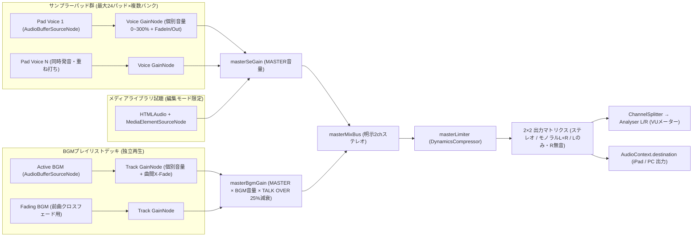

# HIKARUNG-PRO 仕様書・操作マニュアル (AI & 開発者・利用者向け統合ドキュメント)

> **Purpose of this Document (For AI Agents & Developers)**
> このドキュメントは開発者・利用者が、iPad用オフライン対応ポン出し＆BGMプレイリストWebアプリ（PWA）**「HIKARUNG-PRO」** の全体仕様、内部アーキテクチャ、データ構造、操作方法を即座に100%理解できるように構造化した技術仕様書兼マニュアルです。

---

## 1. アプリ概要・設計思想

- **アプリ名**: `HIKARUNG-PRO`
- **開発背景・目的**: 配信イベント・舞台・番組制作でのSE（効果音）・BGM送出に特化したモダンなiPadアプリをApp Store非公開（完全無料・署名期限なし）でiPadに導入・運用する。
- **3大設計原則**:
  1. **100% Offline-First（完全オフライン動作）**:
     - 出先のインターネット無し環境（機内モード・圏外・PC電源オフ）でも、iPad単体で起動・音源追加・波形編集・再生がすべて完結する。
  2. **Zero External Dependency（外部依存ゼロ）**:
     - 外部CDN（Google Fonts、外部JavaScriptライブラリ、外部アイコン等）を一切使用せず、Pure Vanilla HTML5 / CSS3 / ES2022 JavaScript + インラインSVGのみで構築。
  3. **Low-Latency Touch & Audio（超低遅延タッチ＆オーディオ）**:
     - iPadOS / iOS Safari の300msタップ遅延やWeb Audio APIの初回発音ラグを排除し、`pointerdown` 即時発音と `OfflineAudioContext` 並列デコードによりネイティブアプリ同等のレスポンスを実現。

---

## 2. ディレクトリ・ファイル構成

```text
iPadSoundPad/
├── index.html                  # メインUI構造（トップバー、バンクバー、ライブラリ、パッド、VUメーター、BGMデッキ、各種モーダル）
├── styles.css                  # iPadタッチ最適化・ダークテーマCSS
├── js/
│   ├── constants.js            # バージョン・定数・MIME判定ユーティリティ
│   ├── db.js                   # HikarungDB (HikarungProDB v1: メタデータとバイナリを完全分離した5ストア構成)
│   ├── media-library.js        # メディアライブラリ（PCフォルダ監視 / iPadプール / D&D / Web Audio試聴）
│   └── app.js                  # コアアプリ（Audioエンジン、2×2出力マトリクス、VUメーター、波形エディタ、BGMデッキ）
├── sw.js                       # Service Worker（Cache-Firstオフラインキャッシュ制御）
├── manifest.json               # Web App Manifest（standalone全画面表示・ホーム画面アイコン定義）
├── icon.svg                    # アプリアイコン（インラインSVG）
├── icon-180.png                # iPadOSホーム画面用アプリアイコン（180×180 PNG）
├── HIKARUNG-PRO_Standalone.html# サーバー不要・1ファイル完結のスタンドアロン版HTML
├── samples/                    # 初期サンプル音源（SE・BGM 計6種）
└── README.md                   # 本ドキュメント（AI・人間向け総合仕様書＆操作マニュアル）
```

---

## 3. システムアーキテクチャ & オーディオエンジン仕様

### 3.1 オーディオルーティング構造（v4.0.0）



### 3.2 iPadOS Safari 特有の制約回避と高速化ロジック
1. **メタデータ／バイナリ完全分離による起動時 OOM 防止 (`HikarungProDB v1`)**:
   - IndexedDB は `appState` / `audioMeta` / `audioBlobs` / `libraryMeta` / `libraryBlobs` の5ストアに分離。起動時は軽量なメタデータのみ読み込むため、大量の音源やライブラリを保存しても起動時のメモリスパイクが起きない。
   - 30秒未満のSEのみ4件ずつ並列プリデコードし、30秒以上の長尺BGMは再生時オンデマンドデコード＋LRUキャッシュ（RAM常駐上限3曲）で管理。
2. **初回タッチ時のハードウェア即時ウォームアップ**:
   - 画面のどこかを最初にタッチ（`pointerdown`）した瞬間に `ensureAudioContext()` を呼び出し、`AudioContext` の生成・`resume()` と同時に **1サンプルの無音バッファ（`createBuffer(1, 1, 22050)`）を即座に再生**する。これによりiPadOSのオーディオハードウェアが遅延なく起動する。
3. **実効再生レート（スピード×ピッチ）の計算式**:
   - スピード（`speed`: `0.50`〜`2.00`）は `source.playbackRate.value = speed` で制御。
   - ピッチ（`pitch`: `-12`〜`+12` 半音）は `source.detune.value = pitch * 100`（セント単位）で制御。
   - トリミング区間の実再生時間（壁時計時間 `playWallDuration`）は以下の合成レートで算出する：
     $$\text{effectiveRate} = \text{speed} \times 2^{\frac{\text{pitch}}{12}}$$
     $$\text{playWallDuration} = \frac{\text{trimEnd} - \text{trimStart}}{\text{effectiveRate}}$$

### 3.3 パッドの5つの発音モード（`triggerMode`）
| モードID | 表示名 | 挙動仕様 |
| :--- | :--- | :--- |
| `poly` | **POLY** | **重ね再生（同時発音）**。他のパッドと同時発音し、同じパッドを連打すると音が重なって多重発音される（再生中は `×2`, `×3` バッジを表示）。**30秒未満の音源を登録した際の初期値**。 |
| `retrig` | **RETRIG** | **頭出し再生**。他のパッドやBGMとは同時発音しつつ、同じパッドを再度タップした時はそのパッドの前の音を止めて先頭（`trimStart`）から鳴らし直す。 |
| `mono` | **MONO** | **単音切替**。`MONO` に設定されたパッド群の中で常に1つだけが鳴る。別の `MONO` パッドを押すと前の `MONO` パッドが停止し、同じパッドを押すと停止する。 |
| `xfade` | **X-FADE** | **クロスフェード切替**。前に鳴っている他の `X-FADE` パッドを指定のフェードアウト秒数でなめらかに消しながら、新しいパッドをフェードイン再生する。すでに再生中の同じ `X-FADE` パッドをタップするとフェードアウト停止する。**30秒以上の音源を登録した際に自動選択される初期値**。 |
| `gate` | **GATE** | **押下中のみ再生**。指でパッドを押している間（またはキーボードの割当キーを押している間）だけ再生し、指を離すとフェードアウト停止する。 |

---

## 4. データ構造（IndexedDB スキーマ）

データベース名: `KlangPadProDB` (Version `1`)

### 4.1 Object Store: `audioFiles` (KeyPath: `id`)
取り込んだ音源ファイルのバイナリデータを保持するストア。
```json
{
  "id": "aud_1731912000000_a1b2c",
  "name": "オープニングBGM",
  "mimeType": "audio/mpeg",
  "duration": 124.52,
  "arrayBuffer": "<ArrayBuffer (Raw Audio Binary)>"
}
```

### 4.2 Object Store: `appState` (KeyPath: `id`, 固定キー `"main"`)
アプリの全バンク・パッド・プレイリスト・ミキサー設定を保持するストア。
```json
{
  "id": "main",
  "stateData": {
    "gridSize": "4x4",
    "masterVol": 100,
    "masterFadeSec": 3.0,
    "currentBankId": "bank_1",
    "bgmVol": 85,
    "bgmMode": "all_loop",
    "bgmXfade": 3.0,
    "currentPlaylistId": "pl_1",
    "banks": [
      {
        "id": "bank_1",
        "name": "1. オープニング・定番SE",
        "pads": [
          {
            "id": "pad_1731912000_0_xyz",
            "name": "タイトル決定音",
            "audioId": "aud_1731912000000_a1b2c",
            "color": "cyan",
            "triggerMode": "poly",
            "loop": false,
            "key": "1",
            "gain": 100,
            "trimStart": 0.05,
            "trimEnd": 1.78,
            "fadeIn": 0.0,
            "fadeOut": 2.0,
            "speed": 1.0,
            "pitch": 0
          }
        ]
      }
    ],
    "playlists": [
      {
        "id": "pl_1",
        "name": "開場・トークBGMリスト",
        "tracks": [
          {
            "id": "trk_1731912000_0",
            "name": "トークBGM",
            "audioId": "aud_1731912000000_d3e4f",
            "gain": 90,
            "trimStart": 0.0,
            "trimEnd": 64.0,
            "fadeIn": 0.5,
            "fadeOut": 2.5,
            "speed": 1.0,
            "pitch": 0
          }
        ]
      }
    ]
  }
}
```

---

## 5. 画面構成と使い方マニュアル（ユーザーガイド）

### 5.1 上部トップバー（マスター制御・モード切替）
1. **モード切替（`🟢 本番 LIVE` / `🛠️ 編集 EDIT`）**:
   - **`🟢 本番 LIVE`**: パッドをタップした瞬間に音を鳴らす本番用モード。再生中のパッドには残り時間カウントダウン（`-00:05.2`）、下部プログレスバー、個別 `📉FADE`（フェードアウト停止）ボタン、`⏹`（即時停止）ボタンが表示される。
   - **`🛠️ 編集 EDIT`**:
     - **短くタップ**: そのパッドの「波形簡易編集・設定モーダル」を開く。
     - **ロングタップ（約0.25秒長押し）＋スワイプ**: パッドが浮き上がり、別のパッドの上へドラッグ＆ドロップすると**2つのパッドの配置を入れ替える**。
2. **配列（グリッドサイズ）切替**:
   - `3×3` / `4×3` / `4×4` / `5×4` / `6×4` から1画面あたりのパッド数を即座に変更可能。
3. **MASTER音量 & 緊急停止**:
   - **MASTERスライダー**: アプリ全体の出力音量を `0%`〜`150%` でリアルタイム調整。
   - **`📉 全フェード` + 秒数選択（`1.5秒` / `3.0秒` / `5.0秒` / `8.0秒`）**: 現在鳴っているすべてのSEとBGMを指定秒数で一斉にフェードアウト停止する。
   - **`🛑 PANIC!`**: すべてのSE・BGMを即座に強制停止する（キーボードの `Esc` キーでも発動）。
4. **ツールボタン群**:
   - **`📂 一括追加`**: 複数の音源ファイル（MP3/WAV/M4A/AAC/OGG/FLAC）をまとめて選択し、現在のバンクの空きパッドへ順番に自動登録する（**30秒以上の音源は自動で `X-FADE`、30秒未満は `POLY` に設定**）。
   - **`💾 保存 / メニュー`**: アプリ本体のワンタップ更新、全データ（音源バイナリ含む）の `.json` バックアップ書き出し・読み込み、初期化を行う。
   - **`🎵 BGMデッキ`**: 右側のBGMプレイリストデッキの表示／非表示を切り替える（非表示にするとパッドが画面いっぱいに広がる）。

### 5.2 セットリスト（バンク）切替バー
- イベントの進行順（例：`1. オープニング` → `2. トーク・企画` → `3. クイズ・ゲーム` → `4. エンディング`）に合わせてパッドのページをワンタップで切り替える。
- バンクを切り替えても、**前のバンクで再生中の音やBGMデッキの再生は途切れずに継続**する。
- `＋ バンク追加`、`✏️ 名前変更`、`🗑️`（削除）で自由にセットリストを構築可能。

### 5.3 BGMプレイリストデッキ（画面右側）
SEパッドとは独立してBGMを連続再生する専用プレイヤー。
- **プレイリスト管理**: 複数のBGMリスト（開場用、トーク用、盛り上げ用など）を作成・切替可能。
- **リアルタイム・シークバー**:
  - マスター音量バーと同様に、**再生中・一時停止中・待機中いつでも左右にドラッグして指定の秒数を0.1秒単位（`00:34.2 / -01:15.8`）で探索・ジャンプ**できる。
- **`🎙️ TALK OVER` ボタン**:
  - 配信中にMCが喋る際、ワンタップすると再生中のBGM音量を **25%（約-12dB）へなめらかに減衰**させる。もう一度タップすると元の音量へなめらかに復帰する。
- **進行モード**:
  - `🔁 全曲ループ` / `➡️ 順再生` / `🔂 1曲リピート` / `⏹ 1曲停止` / `🔀 シャッフル`
- **曲間クロスフェード**:
  - `なし` / `1.5秒` / `3.0秒` / `5.0秒` / `8.0秒` を選択すると、曲の終わり（または `⏭` 次曲ボタンを押した時）に前の曲をフェードアウトしながら次の曲を自動でフェードインして繋ぐ。
- **MONO連動**:
  - `OFF` / `即停止` / `フェード停止` を選択可能。ONにするとMONOパッドとBGMデッキが排他連動して音被りを防ぐ。
- **各曲の個別波形編集**:
  - 曲リスト右側の `⚙️` ボタンを押すと、SEパッドと全く同じ「波形トリミング・音量・フェード編集モーダル」が開き、BGMの不要な前奏/後奏カットや音量均一化ができる。

### 5.4 波形簡易編集・設定モーダル（パッド＆BGM共通）
パッド右上の `⚙️` ボタン（または編集モードでの短タップ）で開く高機能エディタ。
- **波形キャンバスの直接ドラッグ**:
  - 緑色の `IN ▶` ハンドルとオレンジ色の `◀ OUT` ハンドルを指やマウスで直接左右にドラッグして、開始位置（頭出し）と終了位置（尻切り）を直感的にトリミングできる。
- **ワンタップ便利ツール**:
  - **`✂️ 前後の無音を自動カット`**: 波形先頭・末尾の無音区間（振幅閾値 `0.015` 未満）を自動検出してワンタップで頭出し・尻切りを行う。
  - **`📊 音量を自動均一化 (ノーマライズ)`**: トリミング区間内の最大ピーク振幅を計測し、音割れしない最適レベル（ピーク `0.90` = 約 `-0.9dBFS`）になるよう個別音量ゲイン（`25%`〜`300%`）を自動計算してセットする。
- **5つのオーディオパラメータ調整**:
  1. **🔊 個別音量・ゲイン増幅**: `0%`〜`300%`（元の音が小さい音源も最大3倍まで増幅可能。波形キャンバス上の振幅表示もリアルタイムに連動）。
  2. **📈 フェードイン秒数**: `0.0秒`〜`10.0秒`（波形上に黄色いフェードイン傾斜線を表示）。
  3. **📉 フェードアウト秒数**: `0.0秒`〜`15.0秒`（個別フェード停止時および `X-FADE` 切替時の減衰時間。波形上に黄色いフェードアウト傾斜線を表示）。
  4. **⏩ 再生スピード**: `0.50x`〜`2.00x`（`0.05x` 刻み）。
  5. **🎵 ピッチ（音程変更）**: `-12半音`（1オクターブ下）〜`+12半音`（1オクターブ上）。
- **`▶ トリム・編集状態でテスト試聴`**: 保存前に現在のトリミング・音量・スピード・ピッチ設定でプレビュー再生できる（波形上に白い再生ヘッドが移動）。

---

## 6. iPadへの導入・オフライン化・更新の手順

### 6.1 GitHub Pages からの導入（推奨）
1. インターネット接続環境で、iPadのSafariから公開URL（`https://takeokk.github.io/hikarung-pro/`）を開く。
2. 共有ボタン → **「ホーム画面に追加」** をタップする。
3. Service Worker（`sw.js`）によりアプリ本体がiPad内に完全キャッシュされ、出先のオフライン環境（機内モード等）でもホーム画面アイコンから単体起動できる。
4. サーバーを使わずに試す場合は、単一ファイル版 `HIKARUNG-PRO_Standalone.html` を直接開くことも可能。

### 6.2 アプリ本体の更新方法（音源データを消さずにアップデート）
インターネット接続状態でアプリを開き、右上の **`💾 保存 / メニュー`** → **「🔄 アプリ本体を最新に更新して再読み込み」** をタップする。
これにより、IndexedDB内の音源データやパッド設定を一切消すことなく、Service Workerのキャッシュだけが破棄されて最新版にリロードされる。

### 6.3 音源データの保存仕様（アプリ内コピー保持）
- パッド・BGMプレイリスト・iPad版メディアライブラリへ取り込んだ音源ファイルは、**アプリ内部（ブラウザの IndexedDB）へバイナリごとコピー保存**される。
- そのため、取り込み後に元のファイルやフォルダを移動・削除しても、アプリ上の再生やオフライン起動には一切影響しない。
- パッドやBGMから削除した不要な音源データは自動でゴミ回収（GC）され、メディアライブラリのプールは右上の `🗑️` ボタンから個別にクリアできる。

---

## 7. 他のAIエージェント向けの改修・保守ガイドライン

他のAIがこのリポジトリを編集・機能追加する際は、以下の4ルールを厳守してください：

1. **外部CDNの追加禁止**:
   - 出先のオフライン環境で確実に動作させるため、`index.html` や `styles.css` に外部URL（CDNのJS/CSS/Webフォント等）を追加しないでください。
2. **改修後の必須ビルド手順**:
   - `index.html`, `styles.css`, `app.js`, `icon.svg` のいずれかを編集した場合は、必ず以下2点を実施してください：
     1. `sw.js` 1行目の `CACHE_NAME` のバージョン番号（例: `'hikarung-pro-v2.3.0'` → `'hikarung-pro-v2.4.0'`）をインクリメントする。
     2. `node --check app.js` で構文エラーがないことを確認した上で、`python build_standalone.py` を実行して単一ファイル版 `HIKARUNG-PRO_Standalone.html` を再生成する。
3. **IndexedDBの後方互換性維持**:
   - `HikarungDB` の `dbName` (`'KlangPadProDB'`) や既存の `stateData` 構造を破壊しないでください。新しいプロパティをパッドやトラックに追加する場合は、既存データ読み込み時にデフォルト値へフォールバックする記述（例: `pad.newProp ?? defaultValue`）にしてください。
4. **管理ドキュメントの同期**:
   - 改修作業の開始前には `CONTEXT.md` と `LOG.md` を読み、改修完了時には `CONTEXT.md`, `LOG.md`, および本 `README.md` の仕様記述を最新状態に更新してください。
